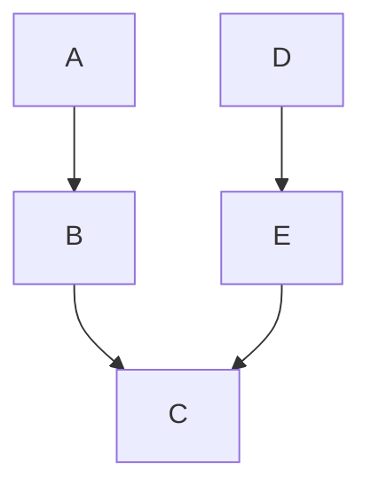

# Jukino

Jukino is a modern API interaction tool for humans and agents, written in Rust.

## Behaviours

### Requests in folders

Jukino manages HTTP requests in folders, the way a file system holds files.

### Collections

Collections group folders and requests along with Environments.

### Environments

Environments hold secrets and values that are accessible from request definitions
called variables.

### Variables

Variables are grouped in Environments and can be created, read, updated or deleted.

### Graph-middleware

The Graph-Middleware offers a flexible way to cascade state across request executions,
a request is a unit of execution in this middleware just like how Go's Chi middleware.

#### Chain runs

By default the folder/request structure defines the chain that requests run in sequence.

A Chain run allows to arrange requests/folders or even collections as units of executions
allowing to run parallel pre-requests or state management middleware and more complex
structures like parallel DAGs that join on certain points, but never a diamond (recursion).

## Interfaces

### Humans

- The `jukino` command-line interface; a user interface (`jukino-ui`).

### MCP

A CLI I/O MCP from jukino cli that allows agents like Claude Code to interact with jukino.

### Mods/Plugins

Specific harness mods like Claude Code for agents to be able to have better access to jukino
features.

## Extending this document

Contributors add to this file as Jukino gains behaviours. Describe what Jukino does for
the person or agent using it. How it is built belongs in [CONVENTIONS.md](CONVENTIONS.md)
and in the design documents under `docs/`.
