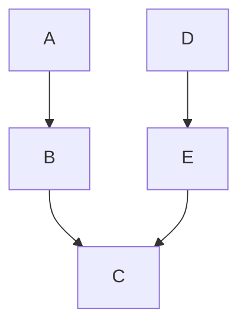

# Jukino

Jukino is a modern API interaction tool for humans and agents, written in Rust.

## Behaviours

### Requests

Jukino uses the [OpenAPI v2 & v3](https://www.openapis.org/) standard to persist
request definitions and interactions.

### Requests in folders

Jukino manages HTTP requests in folders, the way a file system holds files.

### Collections

Collections group folders and requests along with Environments.

### Environments

Environments hold secrets and values that are accessible from request definitions
called variables.

### Variables

Variables are grouped in Environments and can be created, read, updated or deleted
manually or from middlewares; some can be read-only for middleware with
a configured flag.

Variable values can have inter-dependencies only within the same environment, these are
evaluated at read time, this allows to create composed variables.

### Graph-middleware

The Graph-Middleware offers a flexible way to cascade state across request executions,
a request is a unit of execution in this middleware just like how Go's Chi middleware.

Middleware is written in JavaScript, and folders and collections can carry it.

#### Chain runs

By default the folder/request structure defines the chain that requests run in sequence.

A Chain run allows to arrange requests/folders or even collections as units of executions
allowing to run parallel pre-requests or state management middleware and more complex
structures like parallel DAGs that join on certain points, but never a cycle.

#### Imports & Exports

Jukino can export defined requests collections to OpenAPI v2/v3 and supports the import of
API definitions from OpenAPI v2/v3.

## Interfaces

### Humans

- The `jukino` command-line interface
- A desktop and web user interface (`jukino-ui`).

### AI

#### MCP

A CLI I/O MCP from jukino cli that allows agents like Claude Code to interact with jukino.

#### Harness Mods/Plugins

Specific harness mods like Claude Code for agents to be able to have better access to jukino
features.

## Storage

Jukino supports multiple storage drivers, the main one being JSON which is git trackable by
default.

- Memory JSON - A plane JSON file that saves requests by id in a hash map.
- Postgres - A postgres connector that uses JSONB to store requests.

## Extending this document

Contributors add to this file as Jukino gains behaviours. Describe what Jukino does for
the person or agent using it. How it is built belongs in [CONVENTIONS.md](CONVENTIONS.md)
and in the design documents under `docs/`.
